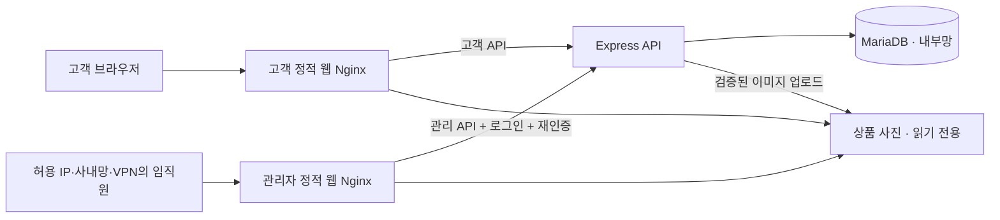

# 부캉커머스몰 반영 내역 및 검증 결과

작성자: 소철현

---

# Part 1. R1·R2 서비스 구축 반영 내역

반영일: 2026.11.07 / 작성자: 소철현

| 요구사항                                  | 구현                                                                                                                                                                       | 검증                                                             |
| ----------------------------------------- | -------------------------------------------------------------------------------------------------------------------------------------------------------------------------- | ---------------------------------------------------------------- |
| R1: 정적 콘텐츠와 사용자 데이터 처리 분리 | 고객 Vue 빌드는 shop Nginx, 관리자 Vue 빌드는 admin Nginx가 제공. 상품 사진은 두 웹 서버가 읽기 전용으로 제공. Express는 회원·상품·장바구니·주문·게시판 API와 DB 처리 담당 | 양쪽 빌드, 실제 Nginx TLS·정적 사진·API 프록시 확인              |
| R2: 고객몰·관리자 사이트 분리             | client/와 admin/을 별도 소스·라우터·빌드로 구성. 고객 앱에서 관리자 컴포넌트와 진입 링크 제거. 관리자 앱에서 별도 로그인 및 15분 재인증                                    | 브라우저에서 고객몰과 관리자 로그인·재인증·상품 목록 확인        |
| 관리자 접근 제한                          | 관리자 Nginx 전체 경로에 IP/CIDR 허용 목록 적용. API는 관리자 프록시의 실제 연결 IP도 확인. 고객 프록시에서는 관리 API와 상품·주문 관리 요청 차단                          | 허용 IP의 접근 및 비허용 IP/위조 X-Forwarded-For의 403 응답 확인 |

## 화면과 API가 연결되는 방식

1. Nginx가 HTML·CSS·JavaScript·캐러셀·상품 사진을 제공합니다. 회원 데이터는 이 정적 파일에 들어가지 않습니다.
2. 브라우저는 현재 사이트의 `/api` 주소로 요청합니다. Nginx가 내부 Express API 서버로 전달합니다.
3. API가 입력과 로그인 정보를 확인한 뒤 MariaDB를 조회하거나 변경하고 JSON을 돌려줍니다.
4. 관리 기능은 허용 네트워크, 관리자 계정, 유효한 재인증 세션을 모두 확인합니다. 일반 로그인만으로 사용할 수 없습니다. 같은 비밀번호를 다시 확인하는 재인증이며 OTP 방식의 다중요소 인증은 아닙니다.
5. 고객 주소로 관리 API를 우회 호출해도 고객 Nginx와 API의 관리자 프록시 검사에서 차단됩니다. CORS나 화면 숨김만으로 보호하지 않습니다.
6. 상품의 가격·재고는 정적 HTML에 고정하지 않고 API로 읽습니다. 사이트가 분리되면 탭 간 storage 이벤트는 전달되지 않으므로 고객 페이지의 포커스 복귀 및 주기적 재조회로 관리자의 수정 사항을 반영합니다.

## 적용 범위와 운영 전 설정

소스·빌드·배포 설정과 로컬 검증을 완료했습니다. 실제 회사의 도메인·TLS 인증서·사내망 주소가 제공되지 않았으므로 외부 서버 배포, DNS 등록, VPN 서버 설치는 수행하지 않았습니다.

IP 허용 방식으로 요구사항을 구현했습니다. VPN이 이미 있다면 해당 VPN의 실제 대역을 허용 목록에 등록할 수 있습니다. 관리자 전체를 공개하는 `allow all`은 사용하지 않습니다. API는 기본적으로 루프백에만 바인딩합니다.

## 검증 결과 (R1·R2 반영 시점)

- MariaDB 통합·단위 테스트 104개 통과, 실패·생략 0
- 고객용 Vue/TypeScript 프로덕션 빌드 통과
- 관리자용 Vue/TypeScript 프로덕션 빌드 통과
- 실제 Windows Nginx 1.30.6에서 검증용 인증서를 이용한 TLS·정적 파일·API·차단 응답 13개 검사 통과

Nginx 검증은 배포 설정에서 실행 경로·API 주소·포트·검증용 인증서 경로를 로컬 값으로 바꾸어 수행했습니다. 검증용 개인키는 배포 소스나 ZIP에 포함하지 않습니다.

## 참고 문서

- [Nginx IP 접근 제어](https://nginx.org/en/docs/http/ngx_http_access_module.html)
- [Express 프록시 신뢰 설정](https://expressjs.com/en/guide/behind-proxies/)

---

# Part 2. v3.2 최신 검증 결과

## 기본 검증

- MariaDB 통합·단위 테스트 106개 통과(실패·생략 0)
- 고객몰 Vue/TypeScript 빌드 통과
- 티셔츠 화이트·블랙, 인형·키링 블루·핑크 선택 및 대표 사진 전환 확인
- 티셔츠 S → M → L → XL 순서와 상품 카드 OPTIONS 표시 삭제 확인
- 색상 옵션 업데이트의 기존 가격·재고 보존 및 반복 실행 검증
- 기존 로고·글자 확대·한국어 버튼·캐러셀 ■ 정지 버튼 유지

Nginx 결과 파일은 서비스 분리 시 수행한 13개 검사 기록입니다. 이번에는 해당 구성을 변경하지 않았습니다.

## 추가 확인: OPTIONS 문구·상세 정보

노트를 포함한 모든 상품 카드에서 OPTIONS 문구가 표시되지 않으며, 공통 상세 정보의 상단 코드·상품코드 항목을 제거했습니다. 고객몰 빌드 및 브라우저 표시 확인 완료.

## 상세 화면 배치 변경

상품명·제품 소재·원산지·색상·옵션을 세로 1열로 배치했습니다. 제품상세 → 상품구매안내 → 리뷰 → Q&A를 항상 이어서 표시하며 상단 링크는 각 영역으로 이동합니다. 하단은 기존 사업자 양식을 참고하되 미제공 정보는 예시로 표시했습니다. 고객몰 빌드, 항목별 행 위치, 네 영역 동시 표시 및 바로가기 이동을 브라우저에서 확인했습니다.

## 최신 기능 검증

통합·단위 테스트 112개 통과. 배송지 독립 저장·재조회·소유권과 회원정보 보존, 로컬 메일 재설정·새 비밀번호 로그인·일회용 링크·메일함 Host/Origin 제한 및 운영 모드 금지를 확인했습니다. 고객몰 빌드 통과, 배송지 수정 폼 및 로컬 메일함 화면 확인 완료. 실제 외부 SMTP 연결은 하지 않았습니다.

## 글꼴 변경

주아(로고·메뉴·제목)와 고운돋움(본문·입력창)을 고객몰·관리자에 적용했습니다. 글꼴·라이선스 파일을 공개 정적 자산에 포함했으며 양쪽 앱 빌드, PC/모바일 글꼴 및 화면 넘침 검증을 완료했습니다. 기존 글자 크기와 #122551 색상은 유지합니다.
